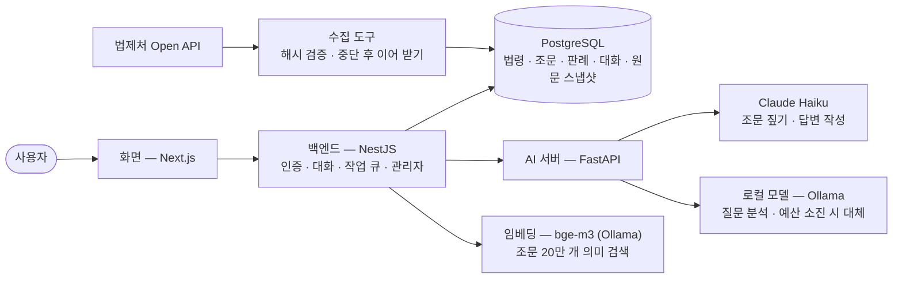
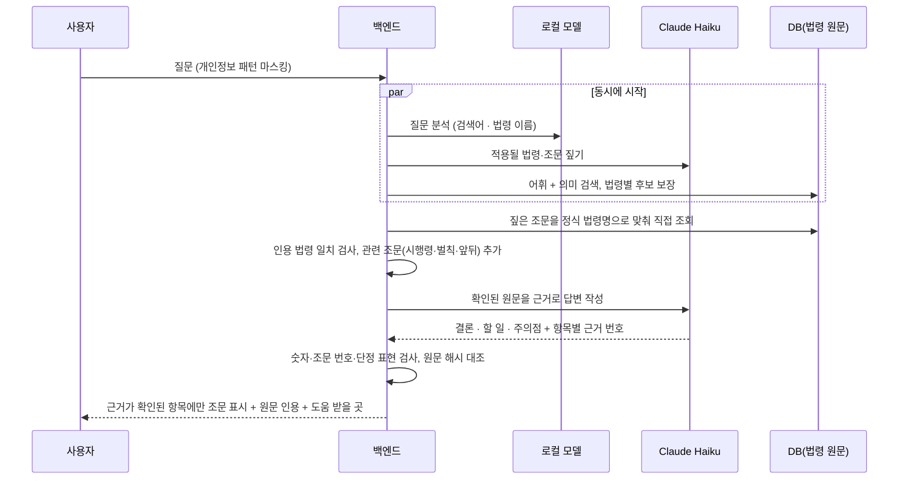
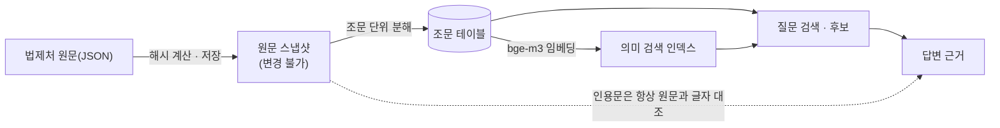

# AURORE (오로르)

**법령 원문을 근거로, 일상의 법률 질문에 쉽고 실질적으로 답하는 AI 서비스**

"집주인이 보증금을 안 돌려줘요", "반려견이 이웃을 물었어요" 같은 질문을 입력하면, AI가 적용될 법령·조문을 찾아 결론과 해야 할 일을 쉬운 말로 알려 주고, **근거가 확인된 내용에는 해당 법령 조문을 붙이고 공식 원문을 함께 보여 줍니다.**

> 법률 자문이 아닌 정보 제공 프로젝트입니다. AI가 만든 설명은 틀릴 수 있습니다. 법령·판례 데이터는 국가법령정보센터(법제처) Open API에서 가져왔습니다.

- 개발 기간: 약 3~4개월(기획·설계 포함, 이전 프로젝트명 Easy Law AI)
- 이 저장소: 백엔드(NestJS), 화면(Next.js), AI 서버(FastAPI), DB 설계(PostgreSQL), 수집·평가 도구, 설계 문서

## 무엇을 하나요
| 영역 | 내용 |
|---|---|
| 대화형 법률 질문 | 결론 → 이렇게 해 보세요 → 알아 둘 내용 → 주의할 점 → 확인해 보세요 → 근거 조문 → 도움 받을 곳. 비회원도 사용, 후속 질문 지원 |
| 근거 표시 | 근거가 확인된 문장에만 "— 근거: 민법 제759조"를 붙이고, 인용문은 법제처 원문과 글자 단위로 대조해 별도로 보여 줌 |
| 법령·판례 열람 | 법령 5,631개(조문 20만 개)와 대법원 판례 1.4만 건 검색, 판본·시행일 비교 |
| 법률용어사전 | 조문 인용 정의, 대화 속 용어 하이라이트·툴팁·사전 이동 |
| 회원·사건 | 회원가입·탈퇴, 사건(Case) 관리, 첨부 문서 근거 확인, 관심 항목, 법령 정정 알림 |
| 관리자 콘솔 | 운영 현황, AI 작업 상태, 법령 갱신·판례 수집 검토·승인, 개인정보 보관 점검, AI 답변 모델 상태 |

## 구조

### 시스템 구성


### 답변이 만들어지는 과정

외부 모델을 쓸 수 없으면(예산 소진, 인증 오류, 과부하) 같은 요청을 로컬 모델이 자동으로 대신 처리합니다.

### 데이터 흐름


## 설계 원칙
- **공식 원문, 검색 조각, 임베딩, AI 설명을 분리**합니다. 인용문은 항상 해시로 고정한 원문과 글자 단위로 대조합니다.
- **환각은 막기보다 관리합니다.** 모델이 아는 지식으로 도움이 되는 답을 쓰되, 근거가 확인된 항목에만 조문을 표시하고, 원문에 없는 숫자(기간·금액)나 조문 번호, "무조건" 같은 단정 표현은 코드가 검증합니다.
- 법률과 무관한 질문에는 답하지 않습니다(전 측정에서 억지 답 0건).
- **소프트 삭제**만 사용하고 물리 삭제를 업무 삭제 수단으로 쓰지 않습니다. 비회원 대화는 1개월 뒤 만료됩니다.
- 사용자 질문은 개인정보 패턴을 가린 뒤 외부 모델로 보내며, 키 값은 로그·화면·파일에 남기지 않습니다.
- 외부 모델 비용·장애를 전제로 설계했습니다(자동 전환, 쿨다운, 관리자 상태 표시).

## 데이터 현황
| 항목 | 값 |
|---|---|
| 법령 | 5,631개(법률·시행령·시행규칙·규칙), 현행 조문 205,980개 전부 임베딩 |
| 판례 | 14,131건(대법원 2010~2026), 검색 + 참조조문 연결 5만 1천 건(판례 1만 3천 건) |
| 법령용어 | 공개 66개, 초안 4,939개, 공식 정의 전체(약 10만 건) 수집 진행 중 |

## 품질
재현 가능한 평가 도구(`backend/tools/evaluate-explanations.mjs`)로 매 변경을 측정했습니다. 처음 보는 질문 30개(홀드아웃) 기준:

| 단계 | 통과 | 오인용 | 평균 시간 |
|---|---|---|---|
| 개선 전(후보 중 고르기, 로컬 모델) | 18/30 | 3 | 6.5초 |
| 검색·선별·해설 개선(로컬 12B) | 25/30 | 1 | 9.9초 |
| **생성형 답변 + Claude Haiku(현재)** | **29/30** | **1** | **11.3초(P95 13.5초)** |

법과 무관한 질문에 억지로 답한 경우는 0건입니다. **합성 질문 30개를 법령 이름 단위로 평가한 값이며 법률 전문가 검토는 받지 않았습니다.** 단계별 수치, 모델 비교(Haiku/Sonnet/로컬), 측정 중 찾아 고친 버그는 [품질 변화 기록](docs/QUALITY_HISTORY.md)에 있습니다.

## 기술 스택
- 백엔드: NestJS, TypeScript, Prisma, PostgreSQL
- 화면: Next.js, React, TypeScript
- AI 서버: Python, FastAPI, Ollama(로컬 모델 · bge-m3 임베딩), Anthropic API
- 운영·도구: Docker Compose(DB), 수집·검증·평가 스크립트(Node), 서비스 감시·자동 재시작 스크립트(PowerShell)
- 테스트: 백엔드 116개 · AI 서버 51개 · 도구 테스트 44개 파일

## 디렉터리
```
backend/      NestJS API (auth, chat, cases, admin, legal, terms, …) + 수집·평가 도구(tools/)
frontend/     Next.js 화면(대화, 사건, 법규·판례 검색, 관리자)
ai-server/    FastAPI: 조문 짚기(legal_propose), 답변(legal_answer), 해설, 문서 근거, 질문 분석
database/     DB 설계·마이그레이션
local-dev/    로컬 실행·모델 전환·서비스 감시 스크립트
docs/         설계 결정, 데이터 수집, 품질 기록, 운영 문서
```

## 실행 방법
Node.js 24, pnpm, Docker, Python 3.13, Ollama가 필요합니다. 비밀값은 `local-dev/.env`와 `frontend/.env.local`에만 두고 저장소에는 넣지 않습니다(예제: `.env.example`).

1. DB: `docker compose`로 PostgreSQL을 띄우고 [백엔드 안내](backend/README.md)의 순서로 마이그레이션을 적용합니다.
2. 백엔드: `backend`에서 `pnpm install --frozen-lockfile`, `pnpm run prisma:generate`, `pnpm run build`, `pnpm run start:prod`
3. 화면: `frontend`에서 `pnpm install --frozen-lockfile`, `pnpm build`, `pnpm start`
4. AI 서버: `ai-server`에서 가상환경에 `requirements.txt`를 설치하고 `uvicorn main:app --port 8001`. 로컬 모델은 `local-dev/models/`의 안내로 준비합니다.
5. 외부 모델(선택): `local-dev/.env`에 `ANTHROPIC_API_KEY`를 넣으면 답변에 Claude Haiku를 쓰고, 없으면 모두 로컬에서 처리합니다.
6. Windows에서는 `local-dev/start-desktop.ps1`로 한 번에 켜고, `local-dev/supervise-desktop.ps1`로 감시·자동 재시작을 할 수 있습니다.

법령 수집은 `backend/tools/collect-current-laws.mjs`, 판례는 `collect-supreme-precedents.mjs`, 임베딩은 `embed-provisions.mjs`입니다. 법제처 Open API 인증값(`MOLEG_OC`)이 필요합니다.

## 한계와 앞으로
- 법무 검토를 거친 약관·개인정보 처리방침, 외부 전송 동의 절차가 없습니다.
- 판례는 참조조문 역인덱스(조문→판례)로 연결해 답변의 "관련 판례" 항목에 쓰지만, 조문 번호가 같다는 이유로 고른 후보라 질문 주제와 안 맞는 경우가 많아 붙는 비율이 낮습니다(30문항 중 3개). 하급심은 수집하지 않았습니다.
- 평가 정답이 조문 단위가 아니고, 질문이 짧은 합성 질문이며 표본이 작습니다.
- 첨부 문서 질문은 이전 방식(로컬 모델)이며 자치법규(조례)는 수집하지 않았습니다.
- 단일 PC 로컬 운영이며 외부 배포·모니터링·사용자 피드백 수집은 아직 없습니다.

## 문서
[개발 현황](docs/PROJECT_STATUS_20261122.md) · [품질 변화 기록](docs/QUALITY_HISTORY.md) · [생성형 답변 설계](docs/GENERATIVE_ANSWER_20261121.md) · [설계 문서 목록](docs/README.md) · [설계 결정 기록](docs/DECISIONS.md)
