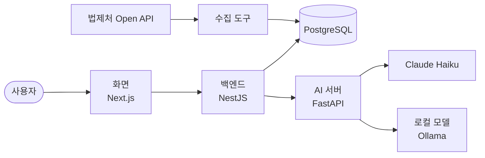

# AURORE (오로르)

법령 원문을 근거로 일상의 법률 질문에 답하는 한국어 서비스입니다.

"집주인이 보증금을 안 돌려줘요", "반려견이 이웃을 물었어요"처럼 평소 말로 물으면, 적용될 만한 법령과 조문을 찾아 지금 할 수 있는 일을 쉽게 설명합니다. 원문에서 근거를 확인한 내용에는 조문을 함께 보여 줍니다.

> 법률 자문이 아니라 정보 제공을 위한 개인 프로젝트입니다. AI가 만든 설명은 틀릴 수 있습니다. 법령과 판례는 국가법령정보센터(법제처) Open API에서 가져왔습니다.

## 할 수 있는 것

- **대화형 질문**: 결론, 할 일, 주의할 점, 근거 조문, 도움 받을 곳 순서로 답합니다. 비회원도 쓸 수 있고, 이어서 물으면 처음 설명한 상황을 기억합니다.
- **근거 확인**: 인용문은 법제처에서 받은 원문과 글자 단위로 대조합니다.
- **첨부 문서**: 계약서 같은 문서나 사진을 올리면 글자를 읽어, 확인한 내용을 바탕으로 설명합니다(회원).
- **법령·판례 찾아보기**: 검색, 시행일별 판본 비교, 관심 항목과 변경 알림.
- **법률용어사전**: 어려운 용어를 조문 인용과 쉬운 풀이로 설명하고, 답변 속 용어에는 도움말이 붙습니다.
- **나의 사건**: 사실관계와 할 일을 정리해 두고 질문에 활용합니다.
- **관리자 화면**: AI 작업 상태, 법령 갱신과 판례 수집 검토, 용어 관리, 답변 모델 상태.

## 구성



질문이 들어오면 질문 분석, 검색(단어 검색과 의미 검색), 조문 짚기를 함께 시작합니다. 모은 조문을 근거로 답을 쓴 다음, 원문에 없는 조문 번호나 단정적인 표현이 있는지 코드로 확인합니다. 외부 모델을 쓸 수 없으면 로컬 모델이 대신합니다. 자세한 흐름은 [구조 문서](docs/ARCHITECTURE.md)에 있습니다.

## 데이터

2026년 11월 26일 기준입니다.

| 항목 | 규모 |
|---|---|
| 법령 | 5,631개(법률, 시행령, 시행규칙 등) |
| 판례 | 약 2만 4천 건(대법원) |
| 법률용어 | 공개 1,000개 |

## 답변 품질

튜닝에 쓰지 않은 질문 30개로 측정했을 때(2026년 11월 22일), 기대한 법령을 인용한 답이 29개였고 평균 11초가 걸렸습니다. 직접 만든 질문이고 법령 이름이 맞는지만 본 결과라서, 법률 전문가가 확인한 정확도는 아닙니다. 측정 과정은 [품질 기록](docs/QUALITY.md)에 적어 두었습니다.

## 실행하기

Node.js 24, pnpm, Docker, Python 3.13, Ollama가 필요합니다. 비밀값은 `local-dev/.env`와 `frontend/.env.local`에만 두고 저장소에는 올리지 않습니다. 필요한 항목은 `.env.example` 파일을 참고하세요.

Windows에서는 준비가 끝난 뒤 한 번에 켤 수 있습니다.

```powershell
powershell -ExecutionPolicy Bypass -File local-dev/start-desktop.ps1
```

처음 설치, 백업, 외부 공개 방법은 [운영 안내](docs/OPERATIONS.md)에 있습니다.

## 폴더

```
backend/     API 서버, Prisma 스키마와 마이그레이션, 수집·평가 도구
frontend/    웹 화면
ai-server/   답변 작성, 문서 읽기, 질문 분석
database/    DB 초기화 스크립트
local-dev/   로컬 실행, 서비스 감시, 외부 공개 스크립트
docs/        설계와 운영 문서
```

## 아직 부족한 점

- 이용약관과 개인정보 처리방침은 법률 검토를 받지 않았습니다.
- 판례는 참조조문을 기준으로 연결해서, 질문 주제와 잘 맞지 않거나 붙지 않는 경우가 많습니다.
- 용어 풀이와 답변은 전문가 검수를 거치지 않았습니다.
- 자치법규(조례)는 다루지 않습니다.
- 컴퓨터 한 대에서 운영합니다.

## 개발

2026년 9월부터 기획, 설계, 구현을 진행했습니다. 이전 이름은 Easy Law AI입니다.
