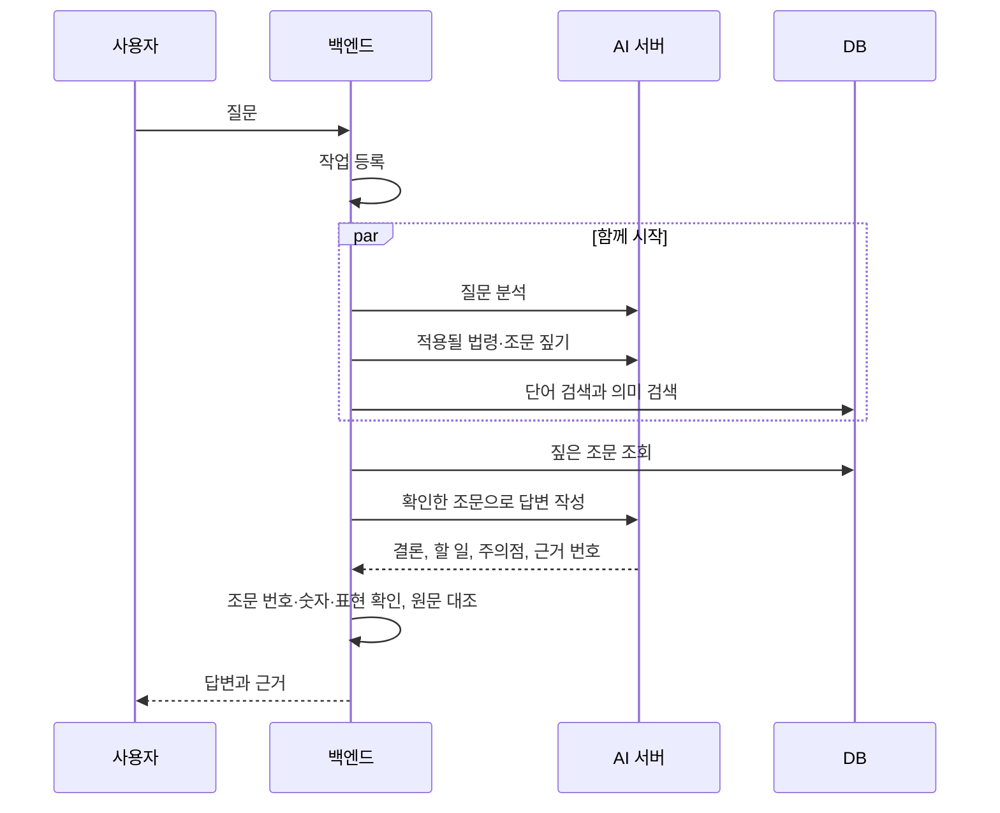

# 구조

## 서비스

| 서비스 | 포트 | 하는 일 |
|---|---|---|
| 화면(Next.js) | 3000 | 웹 화면. 백엔드 호출은 서버에서 합니다. |
| 백엔드(NestJS) | 3001 | 인증, 대화, 답변 작업 큐, 검색, 관리자 기능 |
| AI 서버(FastAPI) | 8001 | 조문 짚기, 답변 작성, 문서 읽기, 질문 분석 |
| PostgreSQL(Docker) | 5433 | 법령, 판례, 대화, 원문 보관 |
| Ollama | 11434 | 로컬 모델과 임베딩(bge-m3) |

외부로 열 때는 화면만 터널로 내보내고 나머지는 같은 컴퓨터 안에서만 접근합니다.

## 원문을 다루는 방식

법제처에서 받은 응답은 해시를 붙여 `src_snapshot`에 그대로 저장합니다. 법령은 여기서 판본과 조문 단위로 풀어 검색에 씁니다. 검색용으로 가공한 글, 임베딩, AI가 쓴 설명은 원문과 따로 두고, 원문을 덮어쓰지 않습니다. 화면에 보여 주는 인용문은 저장한 원문과 글자 단위로 맞는지 확인합니다.

## 답변이 만들어지는 과정

- 답변은 작업 큐에서 처리합니다. 실패하면 다시 시도하고, 사용자가 취소할 수 있습니다.
- 모델이 짚은 법령 이름은 DB의 정식 명칭으로 맞춘 뒤 조회합니다. 맞출 수 없으면 버립니다.
- 근거를 확인한 항목에만 조문을 표시합니다. 원문에 없는 조문 번호나 "무조건" 같은 단정 표현은 걸러 냅니다.
- 법률과 관계없는 질문에는 근거를 붙여 답하지 않습니다.
- 외부 모델이 예산, 인증, 과부하 문제로 실패하면 같은 요청을 로컬 모델이 처리하고, 한동안 로컬을 유지합니다.

## 이어지는 대화

첫 질문은 개인정보 패턴을 가린 뒤 그 대화의 "사건 개요"로 저장합니다. 이후 질문에는 개요를 함께 넘기고, "그럼 어떻게 해?"처럼 앞 내용에 기대는 질문에는 직전 질문과 답변 일부도 붙입니다. 확인된 사실이 아니라 사용자의 설명으로 취급합니다. "나의 사건"의 사실관계는 사용자가 확인해 저장한 것만 씁니다.

## 첨부 문서

문서(PDF, HWP, HWPX, DOCX, 스프레드시트 등)와 이미지에서 글자를 뽑아 사용자에게 먼저 보여 줍니다. 사용자가 확인한 글만 저장하고 답변에 씁니다. 답변은 문서에 있는 내용을 설명하는 부분과 원문 인용으로 나뉩니다. 문서 안에 적힌 지시는 데이터로만 보고 따르지 않습니다.

## 권한과 보관

- 대화, 사건, 첨부는 조회할 때마다 소유자를 확인합니다.
- 사건과 첨부는 회원만 씁니다. 비회원 대화는 한 달 뒤 만료됩니다.
- 질문 횟수에는 한도가 있습니다.
- 외부 모델로 보내는 글은 개인정보 패턴을 먼저 가립니다. 패턴 방식이라 모든 개인정보를 걸러 내지는 못합니다.
